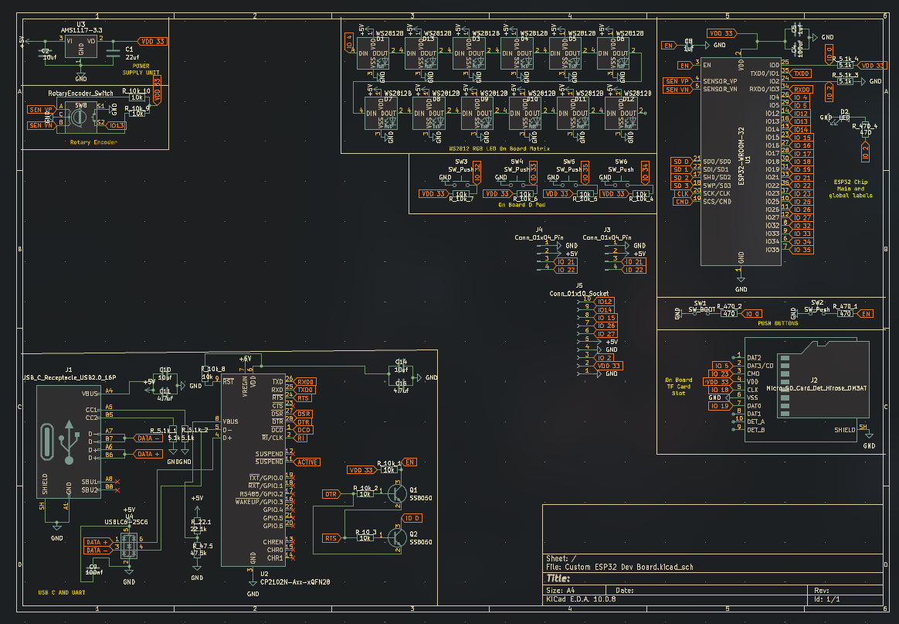
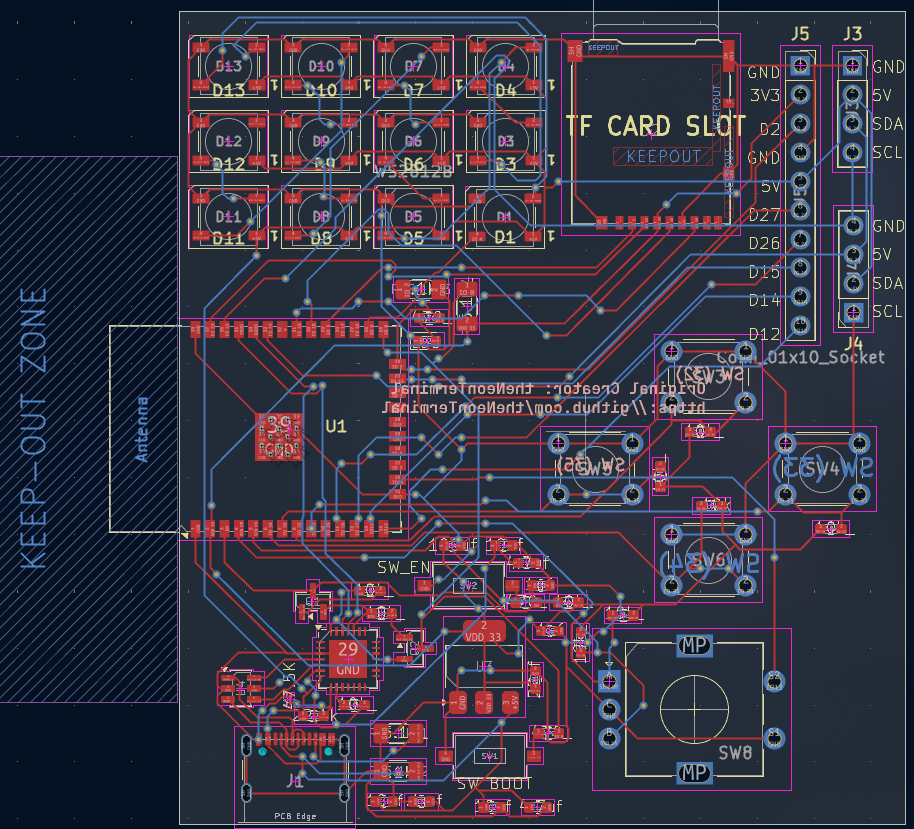
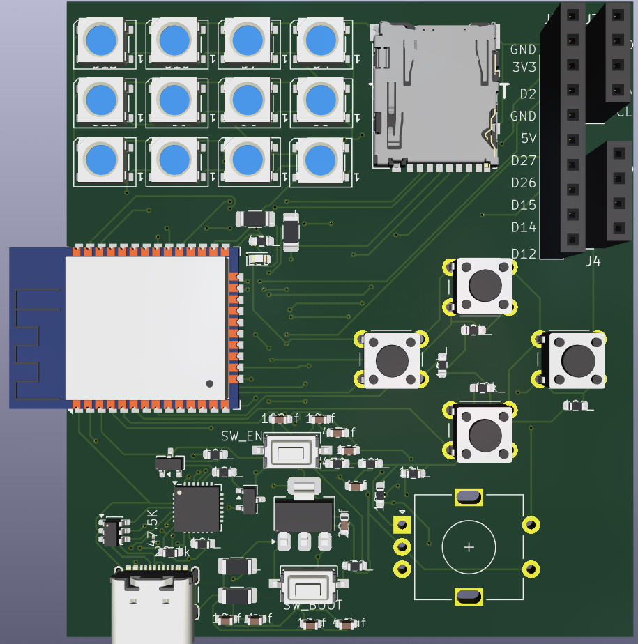
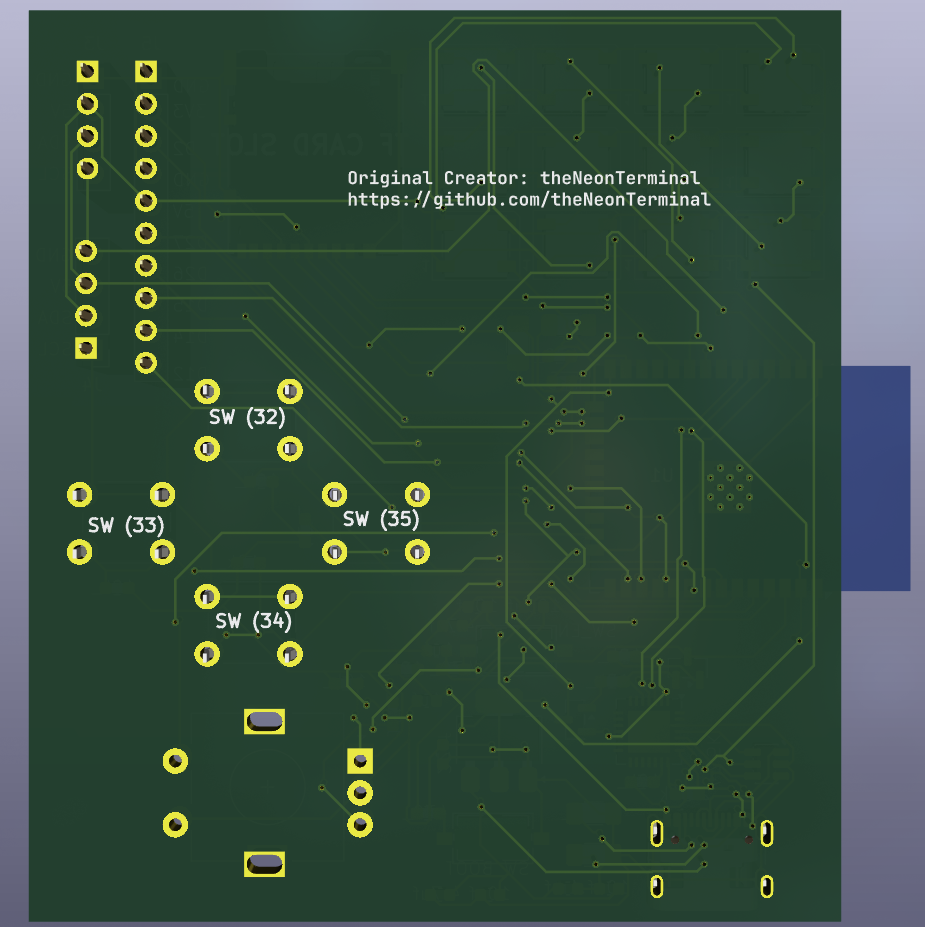

# Custom ESP32 Dev Board

This is my 1st time building a custom ESP32 dev board. This board here features the ESP-WROOM-32D chip and CP2102 USB to TTL for programming the chip. 

---

## Hardware Design

### 01 / Circuit Schematic

### 02 / PCB Layout

### 03 / PCB 3D View

---

## Features:
- Runs on a USB Type C port
- Main Chipset: ESP-WROOM-32D and CP2102 USB to TTL
- Extra Features added to board: 12 WS2812B RGB LEDs, 4 push buttons and a rotary encoder.
- Designed in KiCAD

This is my 1st time with SMD on PCBs, so the component placement / rotuting isnt of the highest quality. But Ill try my best in future attempts, to improve and make my board better and more unique

--- 

## BoM (Bill of Materials)

| PART | QUANTITY | PACKAGE |
| ---- | -------- | ------- |
| ESP-WROOM-32D | 1 | SMD,25.5x18mm |
| Push Button | 4 | 6mm x 6mm THT |
| Push Button | 2 | SMD,25.5x18mm |
| AMS1117 3V3 | 1 | SOT-223 |
| USBLC6-2SC6-FS | 1 | SOT-23-6L |
| SS8050 | 2 | SOT-23 |
| TF Card H1.8 | 1 | SMD |
| USB Type C Port (Female) | 1 | SMD |
| RED LED | 1 | SMD 0603 |
| WS2812B | 12 | SMD5050-4P |
| 1uF cap | _ | SMD 0603 |
| 22uf cap | 1 | SMD 0603 |
| 4.7uf cap | _ | SMD 0603 |
| 10uf cap | _ | SMD 0603 |
| 22.1K resistor | 1 | SMD 0603 |
| 47.5k resistor | 1 | SMD 0603 |
| 10k resistor | _ | SMD 0603 |
| 5.1k resistor | _ | SMD 0603 |
| 470 resistor | _ | SMd 0603 |

